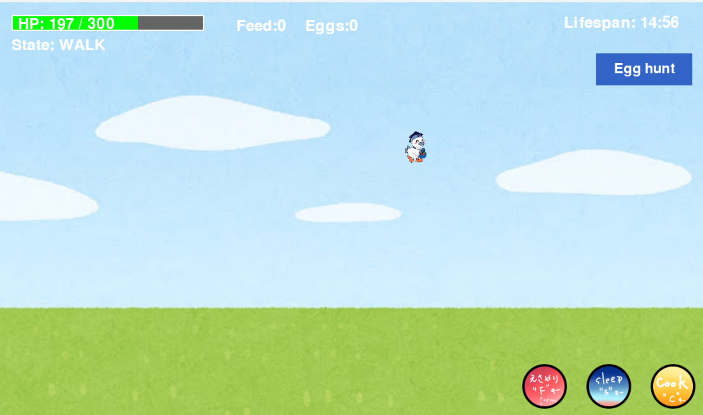
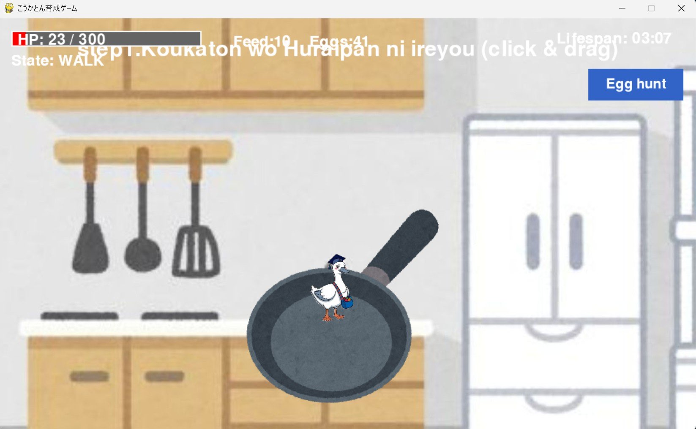
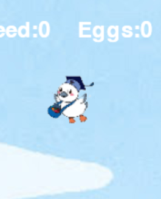
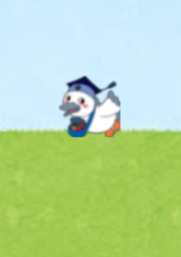
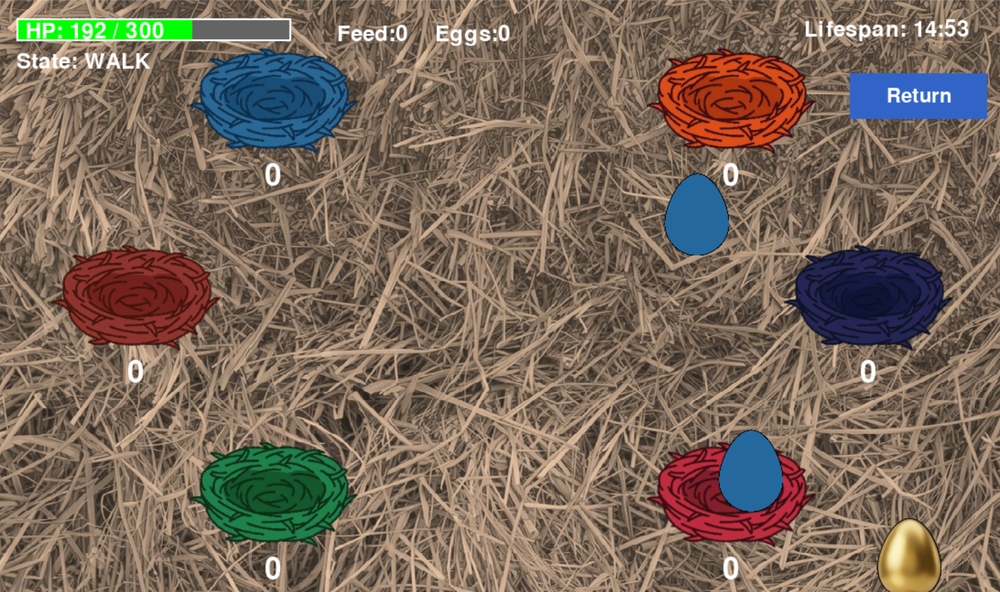

# こうかとん育成ゲーム

## ゲームの概要
* こうかとんを育成するゲーム
* ミニゲームを遊んでご飯を与えよう
* こうかとんの一生を見届けよう
* 参考URL：[サイトタイトル](https://www.hoge.com/)

## ゲームの遊び方
* ミニゲームをプレイして食料を入手する。
* 食料を与えて、こうかとんを成長させる。こうかとんを好きなタイミングで調理する。
* こうかとんの体力が限界を迎えるか寿命を迎えて死んだら調理され、金の卵で子孫が生まれない場合（金の卵がない場合）こうかとんの遺伝子が途絶え、ゲームオーバーになる。
* Fキー：ミニゲームで集めた卵を消費してエサやり（上下キーで与える量を調節）
* Sキー：睡眠して体力を回復（上下キーで選択しEnter）
* Cキー：こうかとんを調理する（上下キーで料理を選択しEnter）
* マウス：ミニゲームでの卵のドラッグ＆ドロップ、脱走時や調理時にこうかとんを捕まえる

## ゲームの実装
### 共通基本機能
* 背景画像とこうかとんの描画
* こうかとんは歩き回る、たまに飛ぶ
* 1秒ごとに体力1減少（飛行中は2減少）
* 初期体力200
* 体力はMax300
* 15分の寿命のこうかとん

### 分担追加機能
#### 調理
* こうかとんの調理
* cキーで調理確認画面に移行
* からあげ・親子丼・丸焼きのいずれかから選択
* からあげ：粉まぶす→油に入れる→完成
* 親子丼(卵所次数が50以上なら作成可能(次世代卵で代用可能))：フライパンにこうかとんを入れる→卵を入れる→ご飯に乗せる→完成！
* 丸焼き：爆発させる→完成！
* 一度調理した場合は寿命を止めている

* 菅原 瑠美
#### 睡眠
* 睡眠で最大5回3分周期30秒回復
* sキーを押すと睡眠をとるか選択できる
* 上下キーで選択しenterを押す
* 180秒経つと睡眠を再びできる

* 武田 英莉
#### 脱走
* 体力半分になったら脱走する
* こうかとん脱走したら飛んで逃げる
* 10秒経過すると完全に逃げてしまいゲームオーバー
* こうかとん脱走したを捕まえたら体力を50減らす

* 宮坂 菜々美
#### 成長
* 成長は5分周期形態変わる
* 15分たったらこうかとん死んじゃう
* 調理画面への切り替え
* 次世代こうかとんの準備

'
 

'

* 古川 流星
#### ミニゲーム
* ミニゲーム：卵の仕分けゲーム
* ミニゲーム仕分ける卵は2～6色
* 15秒ごとに卵の色増やす
* 卵の出現から7秒で卵が腐る
* 金の卵は1度だけ獲得可能
* 卵は画面の上下からランダム出現
* ドラッグ&ドロップで同じ色の巣に仕分ける
* 正しい巣に仕分けると卵を獲得
* 違う色の巣に仕分けるとGAMEOVER
* GAMEOVER時に今回の獲得数と累計獲得数を表示
* ミニゲームのリスタート機能を追加

* 國浦 そうま
#### 餌やり
* 食事で体力が増える
* 食事は卵を与えた数×秒数回復
* Fキーで餌やり
* 上下キーで与える餌の量を調節
* 加藤 千尋

### メモ
* 画面はgame_scene変数で管理
